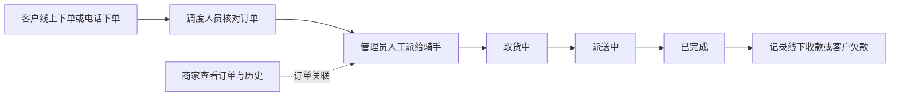

<div align="center">


# 马儿快跑

**面向单城市跑腿团队的订单调度与经营管理平台**

[](https://github.com/Freext-94/maer-kuaipao/tree/v1.0.0)
[](https://github.com/Freext-94/maer-kuaipao/actions/workflows/publish-images.yml)
[](LICENSE)

简体中文

</div>


马儿快跑把客户、商家、骑手和调度人员连接在同一套订单流程里。平台支持线上建单和电话代录、管理员人工派单、骑手履约、商家查看订单，以及订单账单和线下收款记录。适合小型自营跑腿团队在手机和电脑上协同日常业务。

## 产品功能

| 工作台 | 功能 |
|---|---|
| 调度管理 | 统一查看订单，电话代录，人工指派骑手，改单留痕，维护客户、商家、骑手、账号、权限和服务配置 |
| 客户 | 手机下单，查看订单进度与月度账单，登记还款；客户账号由管理员创建 |
| 骑手 | 查看本人任务，登记取货实付，送达时记录收款或欠款，查看历史订单与经手账单 |
| 商家 | 查看关联订单和历史记录；备货与商品结算在线下完成 |

系统预置代买、代取送、代办、代驾等服务类型，管理员可以在设置中启用或配置服务项目。订单主要经过以下流程：



订单状态：**待派单 → 取货中 → 派送中 → 已完成**。未完成订单可取消；改单记录会保留修改内容。客户在线下付款，或由管理员登记收款与欠款，系统不处理在线支付。

## 产品图片


## 快速体验

马儿快跑提供浏览器版工作台，并通过 Docker Compose 部署到 NAS 或 Linux 主机。公开版不附带生产账号或预置客户数据；首次启动时从部署环境读取管理员手机号和密码。

### NAS / Linux 部署

准备 Docker Engine 与 Docker Compose 插件，在服务器上执行：

```bash
git clone https://github.com/Freext-94/maer-kuaipao.git
cd maer-kuaipao/docker
cp .env.example .env
```

编辑 `docker/.env`，为 MySQL、应用数据库和初始管理员分别设置独立强密码，然后拉取并启动服务：

```bash
docker compose pull
docker compose up -d
docker compose ps
```

默认访问地址为 `http://服务器地址:8088`。第一次启动会自动创建数据库结构和初始管理员。建议在反向代理上配置 HTTPS，并定期备份数据库与订单凭证文件。完整说明见[部署指南](docs/deployment.md)。

> GitHub Actions 为 Linux amd64 与 arm64 构建镜像。首次构建完成后，将 GitHub Packages 中的两个容器包设为公开，NAS 即可直接拉取。

## 本地运行

需要 JDK 17、Maven 3.9、MySQL 8、Node.js 20 或更新版本。

1. 创建 `paotui` 数据库，并为应用创建具备数据库读写与 Flyway 迁移权限的账号。
2. 设置数据库连接与初始管理员密码环境变量：`PAOTUI_DB_HOST`、`PAOTUI_DB_PORT`、`PAOTUI_DB_NAME`、`PAOTUI_DB_USER`、`PAOTUI_DB_PASSWORD`、`PAOTUI_ADMIN_PHONE`、`PAOTUI_ADMIN_PASSWORD`。
3. 从 `backend/` 启动 Spring Boot：

   ```bash
   mvn spring-boot:run
   ```

4. 从 `frontend/` 安装依赖并启动网页：

   ```bash
   npm ci
   npm run dev
   ```

MySQL 首次启动时由 Flyway 自动建表。接口与数据库设计见[架构说明](docs/design.md)和[API 概览](docs/api.md)。

## 技术栈

| 部分 | 技术 |
|---|---|
| Web 前端 | Vue 3、Vite、Vue Router |
| 服务端 | Java 17、Spring Boot、MyBatis-Plus、Sa-Token |
| 数据库 | MySQL 8、Flyway |
| 部署 | Docker Compose、Nginx |

## 项目文档

- [部署与运维](docs/deployment.md)
- [架构与业务流程](docs/design.md)
- [API 概览](docs/api.md)
- [品牌素材与视觉规范](brand-kit/brand-guide.md)
- [版本记录](RELEASE.md)
- [参与贡献](CONTRIBUTING.md)

## 产品边界

马儿快跑是单机构、单城市的自营业务平台。当前版本不含在线支付、短信或地图派单；商家备货和骑手结算按线下流程处理。客户、商家、骑手和管理员通过手机号与密码登录，暂不支持免登录下单链接。

## 参与贡献

欢迎提交问题反馈、功能建议和代码贡献。请先阅读[贡献指南](CONTRIBUTING.md)，提交问题时尽量提供复现步骤、预期结果和实际结果。

## 许可证

本项目以 [MIT License](LICENSE) 发布。
