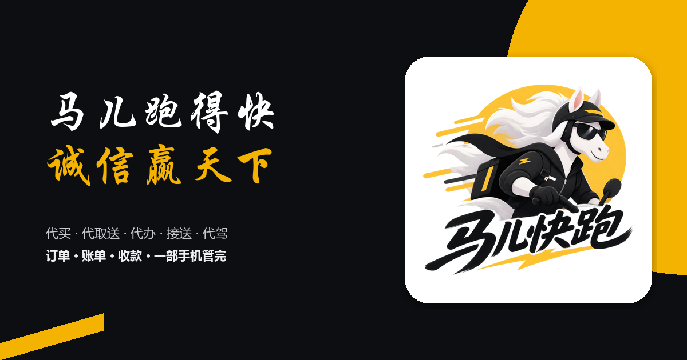

# 品牌资源

马儿快跑品牌资源包含标志、应用图标、网页横幅、分享封面和业务图标。网页运行时使用的图片位于 `frontend/public/brand/` 与 `frontend/public/brand-kit/`；`png/`、`svg/` 目录保存导出的源资源。

## 常用资源

| 资源 | 文件 | 建议用途 |
|---|---|---|
| 应用图标 | `frontend/public/brand-kit/app-icon-512.png` | 应用图标与头像 |
| 登录与网页头图 | `frontend/public/brand-kit/mobile-banner-1500x600.png` | 移动端页头和宣传页面 |
| 分享封面 | `frontend/public/brand-kit/og-cover-1200x630.png` | 社交分享卡片 |
| 导航图标 | `frontend/public/brand/tab-*.svg` | 移动端底部导航 |
| 空页面插画 | `frontend/public/brand/empty-*.svg` | 无订单、无账单提示 |
| 服务图标 | `frontend/public/brand-kit/icons/` | 服务类型标识 |

## 品牌色

| 名称 | 色值 | 使用建议 |
|---|---|---|
| 墨黑 | `#0D0E11` | 标题、深色区域与正文 |
| 品牌黄 | `#F5B301` | 按钮、重点数据和强调信息 |
| 暖白 | `#FFF8E6` | 页面背景和大面积留白 |
| 白色 | `#FFFFFF` | 卡片与 logo 承载背景 |
| 次要文字 | `#8A8A90` | 辅助信息 |

完整的图像使用说明见[品牌规范](brand-guide.md)。
