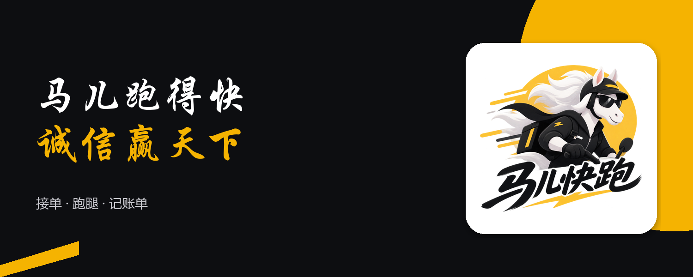

# 品牌视觉规范

## 品牌个性

马儿快跑强调速度、可靠与亲切感。视觉使用卡通马骑手、墨黑与品牌黄，搭配清楚直接的中文信息。品牌口号为：**马儿跑得快，诚信赢天下**。



## 色彩与界面

```css
:root {
  --ink: #0D0E11;
  --brand: #F5B301;
  --cream: #FFF8E6;
  --white: #FFFFFF;
  --muted: #8A8A90;
  --line: #E8E2D6;
}
```

- 主操作使用黄色按钮和深色文字，确保文字对比度。
- 页面优先采用暖白背景与白色卡片，信息层次保持清楚。
- 红色仅用于错误、危险操作和异常提醒。
- 移动端触控区域建议不小于 44 × 44 CSS 像素。

## 标志与图像

标志应保持原始比例和完整构图，不拉伸、不加描边、不单独裁切文字或马头。深色背景使用带白色承载卡片的版本；黄色底色会与标志中的黄色元素混在一起，应避免。

| 场景 | 建议资源 |
|---|---|
| 应用图标 | `frontend/public/brand-kit/app-icon-512.png` |
| 浅色背景 | `frontend/public/brand/logo-512.png` |
| 深色背景 | `frontend/public/brand/logo-card-256.png` |
| 网页与移动端横幅 | `frontend/public/brand-kit/mobile-banner-1500x600.png` |
| 分享封面 | `frontend/public/brand-kit/og-cover-1200x630.png` |
| 账单及业务图标 | `frontend/public/brand-kit/icons/` |

前端访问路径从 `/brand/` 或 `/brand-kit/` 开始。替换视觉资源时保留现有文件名，可以避免修改页面引用路径。
