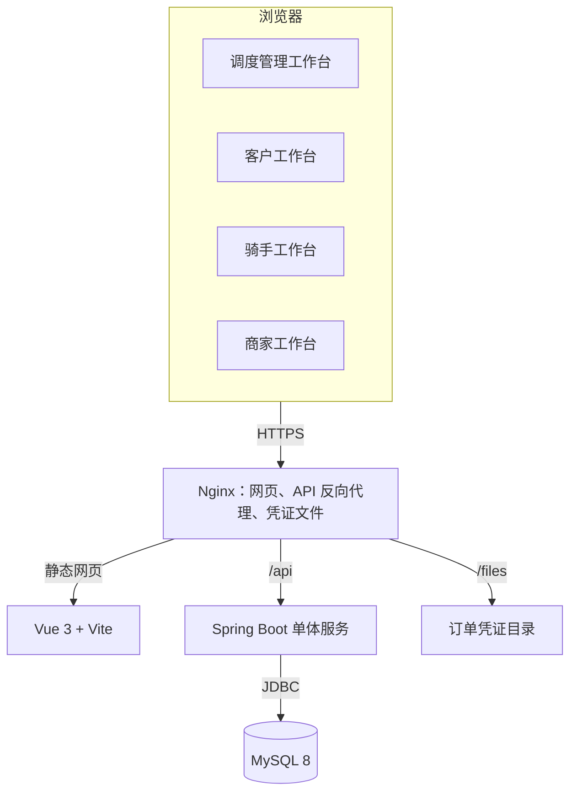
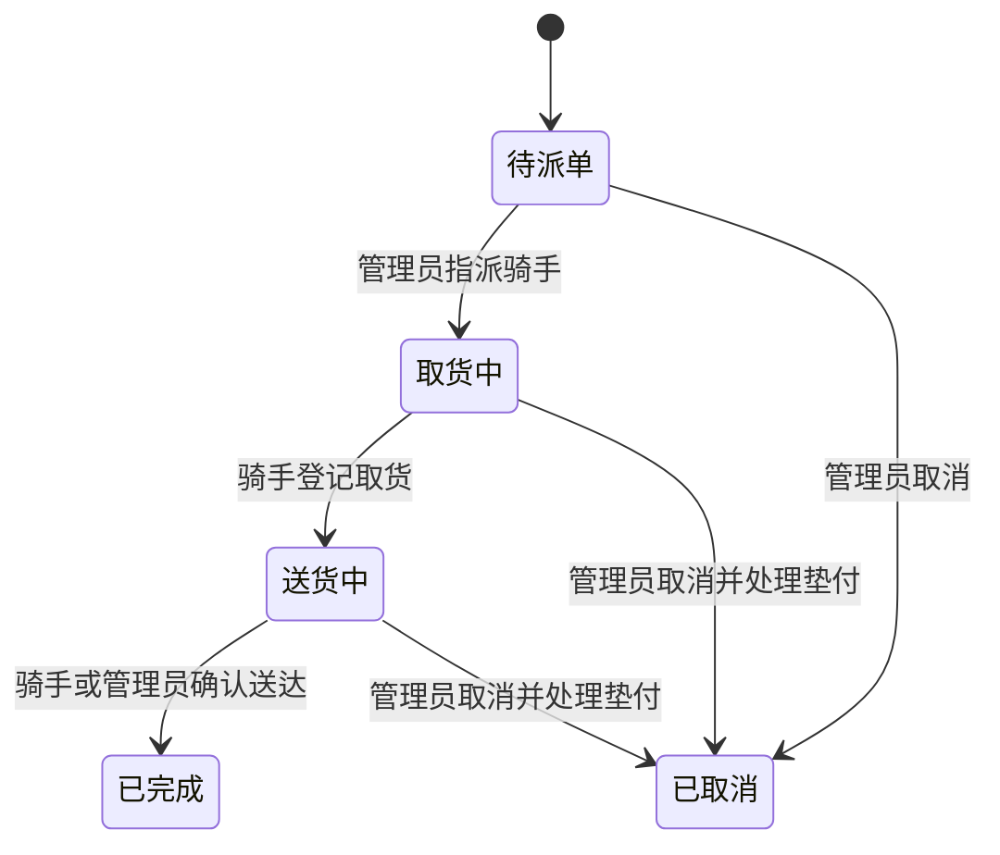

# 架构与业务流程

本文介绍马儿快跑的运行结构、角色边界、订单流程和账务设计。

## 系统结构

网页由 Nginx 提供，业务接口由一个 Spring Boot 服务处理，MySQL 保存业务数据。订单照片和其他附件保存在持久化目录中。Docker Compose 将数据库、服务端和网页分别运行，外部只需开放网页入口。

## 角色与数据范围

| 角色 | 主要职责 |
|---|---|
| 超级管理员 | 管理全部账号、角色、管理员权限、订单和系统设置 |
| 管理员 | 按授权查看及处理订单、客户、商家、骑手和账单 |
| 客户 | 创建订单，查看本人订单和账单，登记还款 |
| 骑手 | 查看派给本人的任务，登记取货和配送完成，查看本人订单与账单 |
| 商家 | 查看与本店相关的待处理订单及历史订单 |

同一手机号可以拥有多个角色。服务端从登录会话确定当前用户与角色范围，不信任客户端提交的用户归属标识；管理员写操作会写入审计记录。

## 订单流程

订单可由客户在线创建，也可由管理员电话代录。管理员确认服务内容和费用后人工派单；骑手记录实际货款并开始配送，完成时记录实收金额。商家在工作台查看关联订单，备货、商品款交接在线下完成。

未完成订单可根据授权进行改单，系统保存编辑日志。订单完成或取消后不再开放普通改单。取消时若存在骑手垫付，须记录追回金额或确认损失后才能结束订单。

## 账务模型

- 金额以整数分保存，页面显示时换算为元。
- 客户应收、已收和欠款由订单与流水计算，不单独维护可编辑的余额字段。
- 账务流水只新增，不直接改写或删除；纠正金额时通过新的调整流水处理。
- 线下现金、转账等收款由操作人员记录。客户还款申报需要管理人员核对后入账。
- 骑手垫付单独记录；订单不能在垫付尚未追回或确认损失时结束。

数据库表结构由 `backend/src/main/resources/db/migration/` 中的 Flyway 脚本创建和升级。图片等凭证不写入数据库大字段，数据库保存其文件记录和引用信息。

## 安全与部署边界

- 四类用户均通过手机号和密码登录，管理员为客户、商家和骑手创建账号。
- API 根据用户角色限制可访问范围；管理员写操作受权限配置约束。
- 对外部署时建议启用 HTTPS、为数据库和管理员设置独立密码，并限制数据库端口的外部访问。
- 单实例部署适用于单机构业务。高可用、多机构隔离和对象存储不属于当前版本范围。
